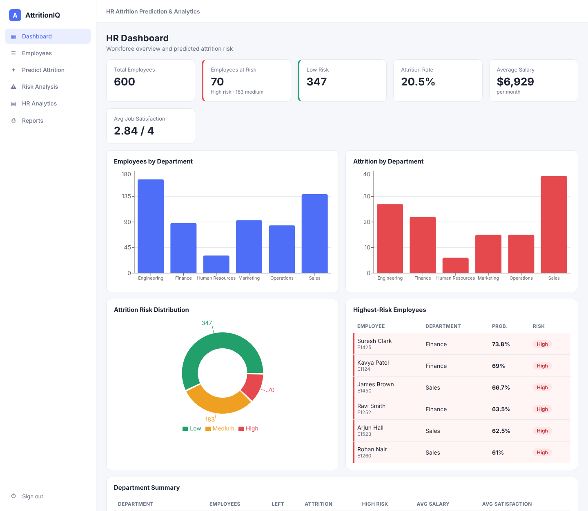
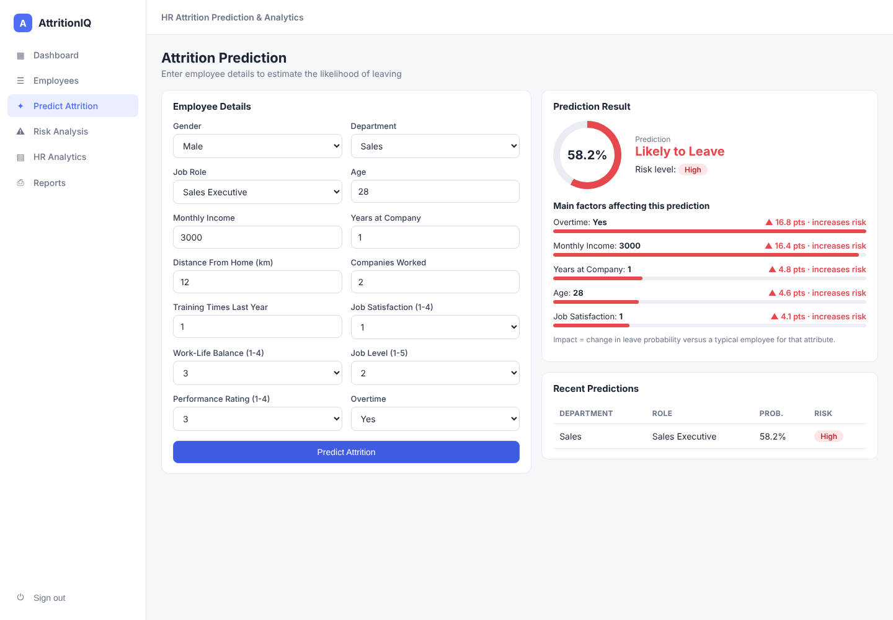
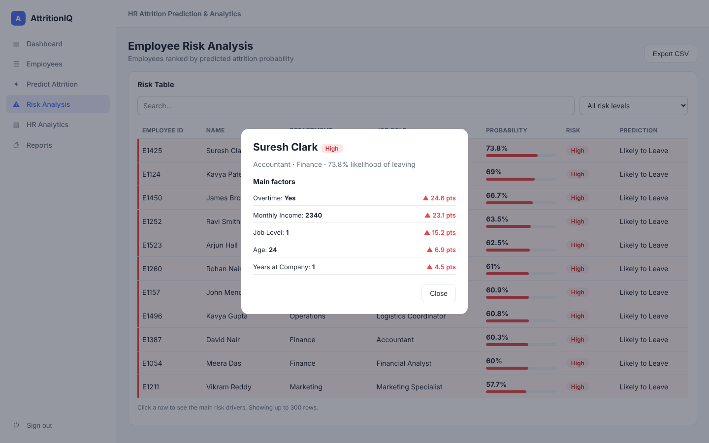
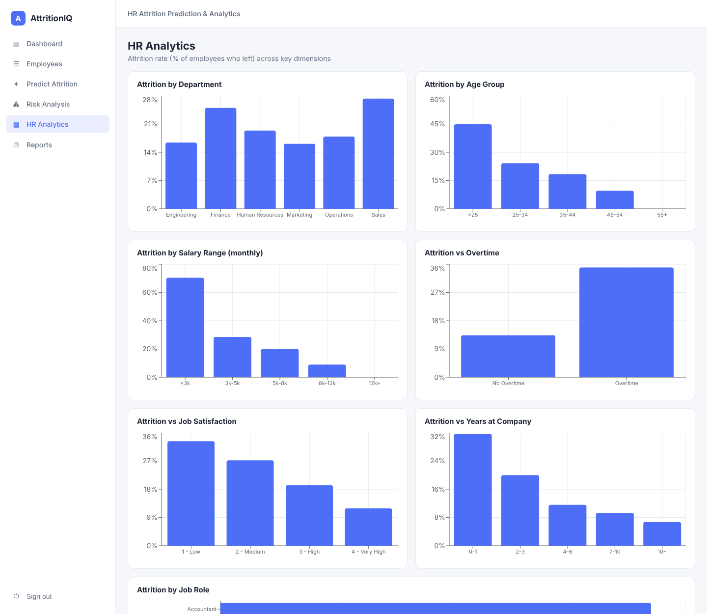
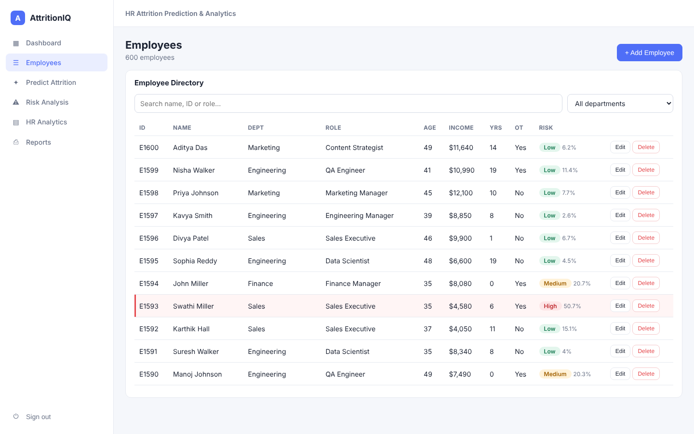

# AttritionIQ – AI-Powered Employee Attrition Prediction & HR Analytics

Full-stack app: **React** (Vite + Recharts) · **Flask** · **scikit-learn** (Random Forest) · **SQLite** (built in – no external DB).

## Screenshots

Captured from the running app with its built-in sample data (600 synthetic employees).



| Attrition prediction | Risk analysis (click a row for drivers) |
|---|---|
|  |  |

| HR analytics | Employee directory |
|---|---|
|  |  |

## Quick start

Requires Python 3.9+ and Node.js 18+.

**1. Backend** (terminal 1)
```bash
cd backend
python -m venv venv && source venv/bin/activate      # Windows: venv\Scripts\activate
pip install -r requirements.txt
python app.py
```
On first start it automatically creates `backend/database.db`, the tables (`users`, `employees`, `predictions`), an admin user, 600 sample employees, trains the model and saves it to `backend/model/`. API runs at http://127.0.0.1:5000.

**2. Frontend** (terminal 2)
```bash
cd frontend
npm install
npm run dev
```
Open **http://localhost:5173** and log in with **admin / admin123**.

*Single-server option:* run `npm run build` in `frontend/`, then just `python app.py` and open http://127.0.0.1:5000.

## Features
| Page | What it does |
|---|---|
| Login | Credentials stored (hashed) in SQLite; signed session token |
| Dashboard | KPI cards, employees & attrition by department, risk distribution, top high-risk table |
| Employees | Add / edit / delete, search, department filter – all persisted in SQLite; risk re-scored on every change |
| Predict Attrition | Form → Likely to Leave/Stay, probability %, Low/Medium/High risk, top contributing factors |
| Risk Analysis | Ranked risk table, high-risk rows highlighted, click for drivers, CSV export |
| HR Analytics | Attrition by department, job role, age group, salary range, overtime, satisfaction, tenure |
| Reports | Summary stats, department table, high-risk list, CSV export (employees / risk), model retrain |

## ML details (`ml/attrition_model.py`)
- Data loaded from SQLite `employees` table (`attrition` = Yes/No is the label).
- Preprocessing: one-hot encoding for categoricals, standard scaling for numerics (scikit-learn `ColumnTransformer` + `Pipeline`).
- Model: `RandomForestClassifier`, saved with joblib to `backend/model/attrition_model.joblib`.
- Stored risk for existing employees uses 5-fold **out-of-fold** probabilities (not inflated by training-set memorisation).
- Risk levels: **Low** < 20%, **Medium** 20–40%, **High** ≥ 40% (High ⇒ "Likely to Leave"). Thresholds in `LOW_MAX`/`MEDIUM_MAX`.
- "Main factors": each feature is swapped for the typical (median/mode) value and the change in probability is reported.
- Retrain from the Reports page, or `python ml/train.py`.

## Sample data
`ml/generate_data.py` creates 600 synthetic employees (fixed seed) with realistic attrition patterns. To start fresh, delete `backend/database.db` and `backend/model/*.joblib`, then restart. To use your own data, add employees through the UI (or insert into the `employees` table) and click **Retrain model**.

## Structure
```
employee-attrition-system/
├── frontend/          React app (src/pages, src/components, src/api.js)
├── backend/
│   ├── app.py         Flask entry point
│   ├── database.py    SQLite schema + seeding
│   ├── ml_service.py  Flask ↔ ML glue
│   ├── database.db    (auto-created)
│   ├── model/         saved model (auto-created)
│   ├── routes/        auth, employees, predict, analytics, reports
│   └── requirements.txt
├── ml/                attrition_model.py, generate_data.py, train.py
└── README.md
```

## API (all `/api`, Bearer token except login)
`POST /auth/login` · `GET|POST /employees` · `PUT|DELETE /employees/<id>` · `GET /employees/meta` · `POST /predict` · `GET /predict/history` · `GET /risk?level=` · `GET /employees/<id>/factors` · `GET /dashboard` · `GET /analytics` · `GET /reports/summary` · `GET /reports/export?type=employees|risk` · `GET /model/info` · `POST /model/retrain`

## Notes
Change the default password and set `SECRET_KEY` env var before any real deployment. Sample data is synthetic.
